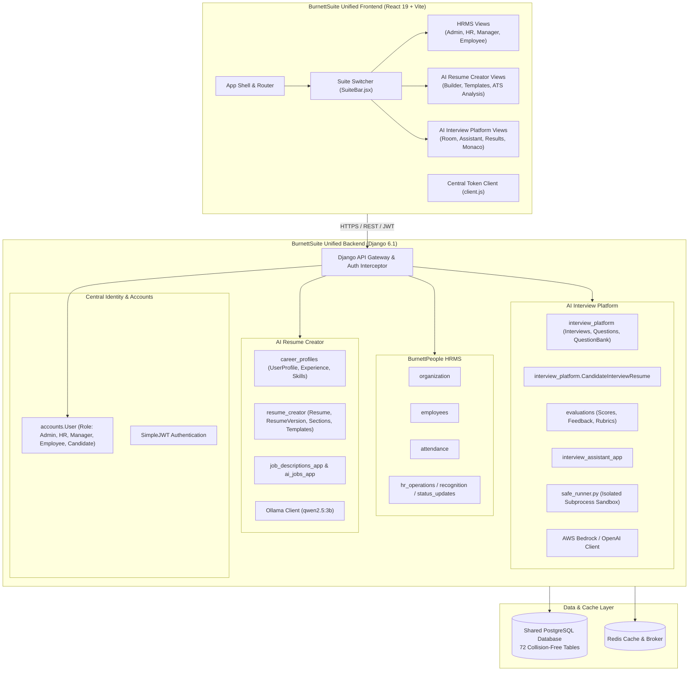

# BurnettSuite Unified System Architecture

## 1. Executive Summary

BurnettSuite integrates three previously separate products into **one unified application, single repository, and coordinated deployment unit**:
1. **BurnettPeople** — Enterprise Human Resource Management System (HRMS), identity foundation, employee lifecycle, organization hierarchies, and attendance.
2. **AI Resume Creator** — Intelligent resume builder, version control, ATS gap analysis, and job description parsing powered by Ollama (`qwen2.5:3b`).
3. **AI Interview Platform** — Interactive mock interview preparation, automated question generation, audio evaluation, and isolated coding sandbox powered by AWS Bedrock (`zai.glm-4.7-flash`, `nvidia.nemotron-super-3-120b`).

---

## 2. Core Architectural Pillars

### A. Single Identity and User Model
- **Single Source of Truth:** `backend/accounts.User` (`AUTH_USER_MODEL`) is the sole identity model across all modules.
- **Unified Roles:** `ADMIN`, `HR`, `MANAGER`, `EMPLOYEE`, and `CANDIDATE`.
- **Public Candidate Registration:** Self-service registration at `/api/auth/register/` automatically provisions candidate credentials and initializes an associated career profile in `career_profiles.UserProfile`.
- **Duplicate Auth Elimination:** Redundant auth endpoints from standalone resume and interview projects have been removed and consolidated under `/api/auth/` (with compatibility aliases preserved at `/api/v1/auth/` and `/api/users/`).

### B. Single Database with Logical Domain Separation
- **Unified PostgreSQL Connection:** All applications use `DATABASES["default"]` (with automatic fallback to SQLite for local development and unit tests).
- **Collision-Free Table Names:**
  - `resume_creator_resume` (Resume Creator builder & versioning)
  - `interview_candidate_resume` (Interview Platform uploaded documents)
  - `resume_creator_analysis` (Resume Creator ATS job description gap analysis)
  - `interview_resume_analysis` (Interview Platform candidate profile evaluation)
  - `career_*` (Career profiles, experiences, skills, education, projects)
- **72 Distinct Tables:** Zero table collisions or cross-app namespace conflicts.

### C. Security Sandbox: Safe Code Execution
- **Hazard Eliminated:** Standalone interview platform previously ran arbitrary student code using Python's `exec()` inside the web server process.
- **Isolated Subprocess Runner:** Replaced with `backend/interview_platform/safe_runner.py`:
  - Executes in an isolated Python subprocess (`sys.executable -I -s`).
  - Strict 5.0-second execution timeout.
  - Output truncation at 16 KB.
  - Safe capture of stdout, stderr, and execution exceptions without risking the host server.

### D. Unified Frontend & Design System
- **Single SPA:** One React 19 + Vite 8 frontend located in `frontend/`.
- **Design System Foundation:** BurnettPeople's teal/mint branding palette (`#004d40`, `#00796b`, `#e0f2f1`, `#ffffff`), typography, and `DashboardShell`.
- **Top Suite Switcher (`SuiteBar.jsx`):** Enables authenticated users to switch seamlessly between:
  - 🏢 **HRMS Workspace** (Admin, HR, Manager, Employee)
  - 📄 **AI Resume Creator** (All authenticated users)
  - 🎙️ **AI Interview Platform** (All authenticated users)
  - 👤 **Career Profile** (All authenticated users)
- **Unified Session & Token Management:** `frontend/src/api/client.js` transparently synchronizes access and refresh tokens across `burnett_access_token`, `access_token`, and `resumeai-access-token` in memory and `localStorage`.

---

## 3. High-Level System Architecture Diagram

---

## 4. API Route Namespaces

| Domain | Base Path | Description |
|---|---|---|
| **Identity & Auth** | `/api/auth/` | Central login, register, token refresh, me, logout, password reset |
| **Compatibility Aliases** | `/api/v1/auth/`, `/api/users/` | Backward compatibility aliases for legacy clients |
| **Employees** | `/api/employees/` | Employee CRUD, profiles, directory |
| **Attendance** | `/api/attendance/` | Clock-in, clock-out, records, shifts |
| **Organization** | `/api/organization/` | Departments, positions, hierarchy |
| **HR Administration** | `/api/admin/`, `/api/hr/` | Audit logs, settings, reports, metrics |
| **AI Resume Creator** | `/api/v1/resumes/` | Resume CRUD, versions, export |
| **Resume Sections** | `/api/v1/resume-sections/` | Section reordering, editing, bullets |
| **Career Profiles** | `/api/v1/profile/` | Experience, projects, skills, education |
| **Job Descriptions** | `/api/v1/job-descriptions/` | Upload, parse, import JD records |
| **ATS Gap Analysis** | `/api/v1/analysis/` | Match score, missing keywords, suggestions |
| **AI Background Jobs** | `/api/v1/ai-jobs/` | Async job submission, status polling |
| **Interviews** | `/api/interviews/` | Interview creation, room session, completion |
| **Candidate Resumes** | `/api/resumes/` | Interview candidate resume upload & parse |
| **Interview AI & Assistant** | `/api/ai/`, `/api/assistant/`| Question generation, voice assistant, models |
| **Evaluations** | `/api/evaluations/` | Evaluation scoring, feedback, metrics |
